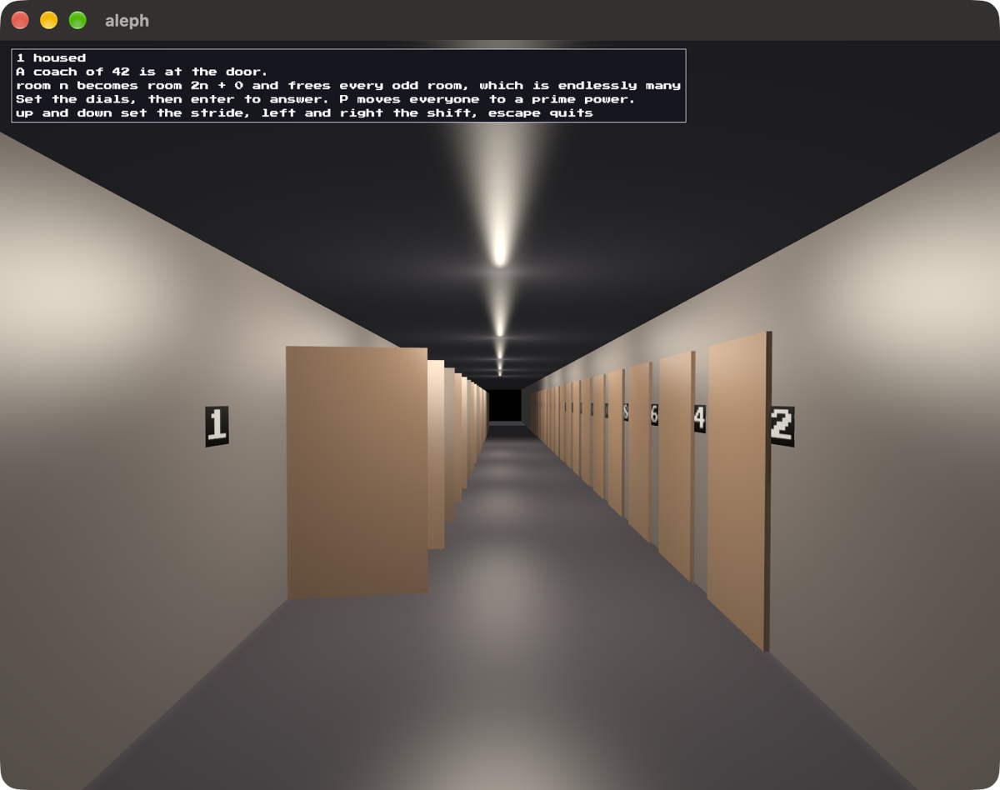

# aleph

A hotel with a room for every counting number, and every room is taken. Coaches
keep arriving and each wants more than the last. You make space by moving the
guests who are already in, all of them at once, with one rule.

Rooms run 1, 2, 3 and on without end, odd down the left side and even down the
right. One rule moves everybody: room n becomes room a·n + b. You set a and b
on two dials and the corridor rearranges. A shut door is a room with somebody
in it and an open one is free.

The picture is the doubling rule, a of 2 and b of 0. It sends every guest into
an even room, so the whole left wall opens at once. That is what freeing
infinitely many rooms looks like.

## Parked

Built on 2026-10-04 and put down the same night. The corridor works and the
game does not, for three reasons that [the spec](specs/0001-the-night.md) keeps
so nobody has to find them twice.

Its manifest is named `Cargo.toml.not-yet`, which is what holds it out of the
project's gate and its listings. Rename it back to `Cargo.toml` to pick this
up, and `cargo run` from here.

Built on [blitzkit](https://github.com/jvalol/blitzkit).

---

I asked AI to draft this for me. I've edited it. Any surviving AI smells are my oversight.
